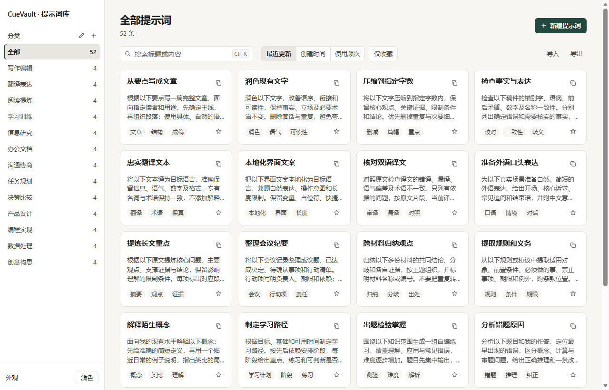
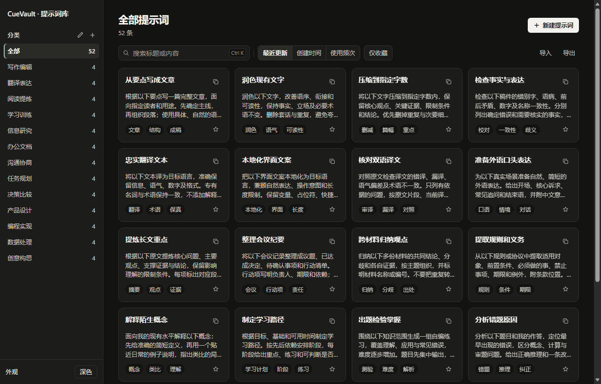

# CueVault · 提示词库

<p align="center">
  
</p>

<p align="center">
  <strong>极简、私密、开箱即用的 AI 提示词管理工具</strong>
</p>

<p align="center">
  支持 Windows 原生桌面端与浏览器单文件独立运行，数据全本地存储。
</p>

---

## 界面预览

### 浅色模式


### 深色模式


---

## 核心特性

- **双模态运行**
  - **桌面端**：基于 Tauri 2 + Rust + SQLite 构建，体积小巧（约 6.5 MB），启动迅速，低内存占用。
  - **单文件独立版**：单 HTML 文件（`提示词管理.html`），双击即可在任何现代浏览器中运行，无需额外依赖。
- **内置预设提示词库**
  - 精选内置 13 大通用领域、共 52 条结构化通用提示词模板：写作编辑、翻译表达、阅读提炼、学习训练、信息研究、办公文档、沟通协商、任务规划、决策比较、产品设计、编程实现、数据处理、创意构思。
  - 每条模板含明确的输入占位符（如 `[填写]`、`[粘贴]`），支持 3～5 个精细化用途标签。
- **场景变体与标签分类**
  - 支持多场景变体管理，单条提示词可在同一卡片内自由切换多个细分版本。
  - 标签化检索系统，支持按分类、用途标签、收藏状态与关键词实时组合过滤。
- **即用即走的高效交互**
  - 临时就地编辑：点击卡片可直接微调占位参数并一键复制，不污染预设原模板；确认需要沉淀时可一键持久化保存。
  - 分页与流畅渲染：大数据量下分页浏览，保持高效响应。
- **纯本地数据隐私**
  - 零外部云端依赖，桌面端采用 SQLite 本地数据库，网页端采用 LocalStorage。
  - 支持一键导出与导入标准 JSON 备份。

---

## 快速使用

### 1. 便携桌面版（推荐）
在 [Releases](https://github.com/rowanjove/CueVault/releases) 页面下载最新的 `CueVault-v0.1.0-windows-x64.zip` 或 `CueVault.exe`：
- 解压后双击 `CueVault.exe` 即可使用，无需安装。
- 绿色便携模式：数据默认存储在程序同目录的 `data/prompt-library.db`，可随 U 盘或移动硬盘直接携带。

### 2. 浏览器独立版
直接在仓库中下载或双击打开 `提示词管理.html`：
- 支持 Chrome、Edge、Firefox、Safari 等现代浏览器。
- 数据保存在当前浏览器本地，支持导入导出 JSON 提示词库。

---

## 本地开发与构建

### 环境要求
- [Rust](https://www.rust-lang.org/) (建议最新稳定版)
- [Node.js](https://nodejs.org/) (用于运行前端单元测试，v18+)
- Windows 10/11，系统内置 WebView2 运行时

### 运行测试
```bash
# 运行前端与数据结构测试
node --test tests/frontend.test.cjs

# 运行 Rust 存储引擎测试
cargo test --manifest-path src-tauri/Cargo.toml
```

### 构建发布版本
```bash
# 编译生产 Release 二进制文件
cargo build --release --manifest-path src-tauri/Cargo.toml
```
编译产物位于 `src-tauri/target/release/CueVault.exe`。

---

## 开源协议

本项目基于 [MIT License](LICENSE) 开源。
